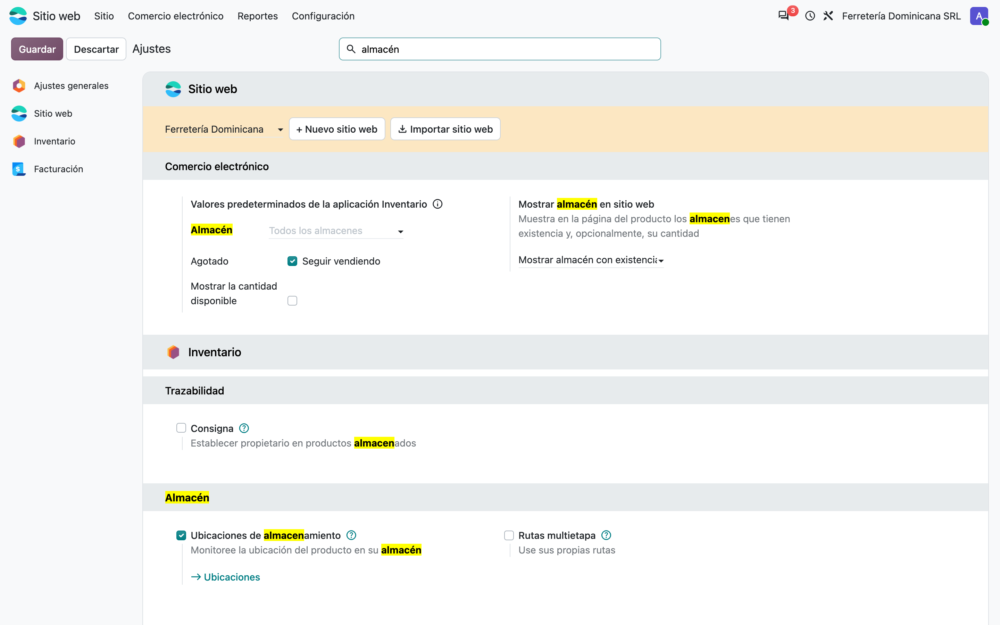
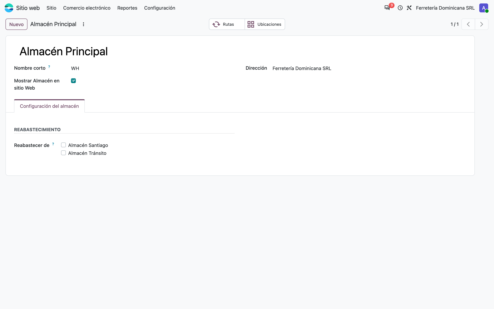
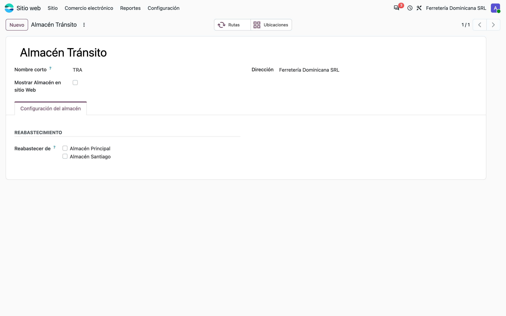
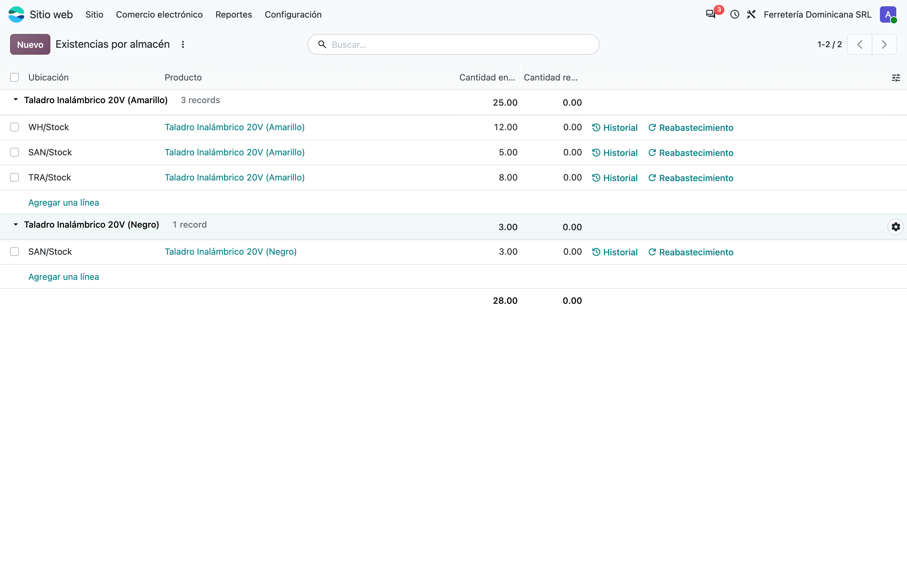
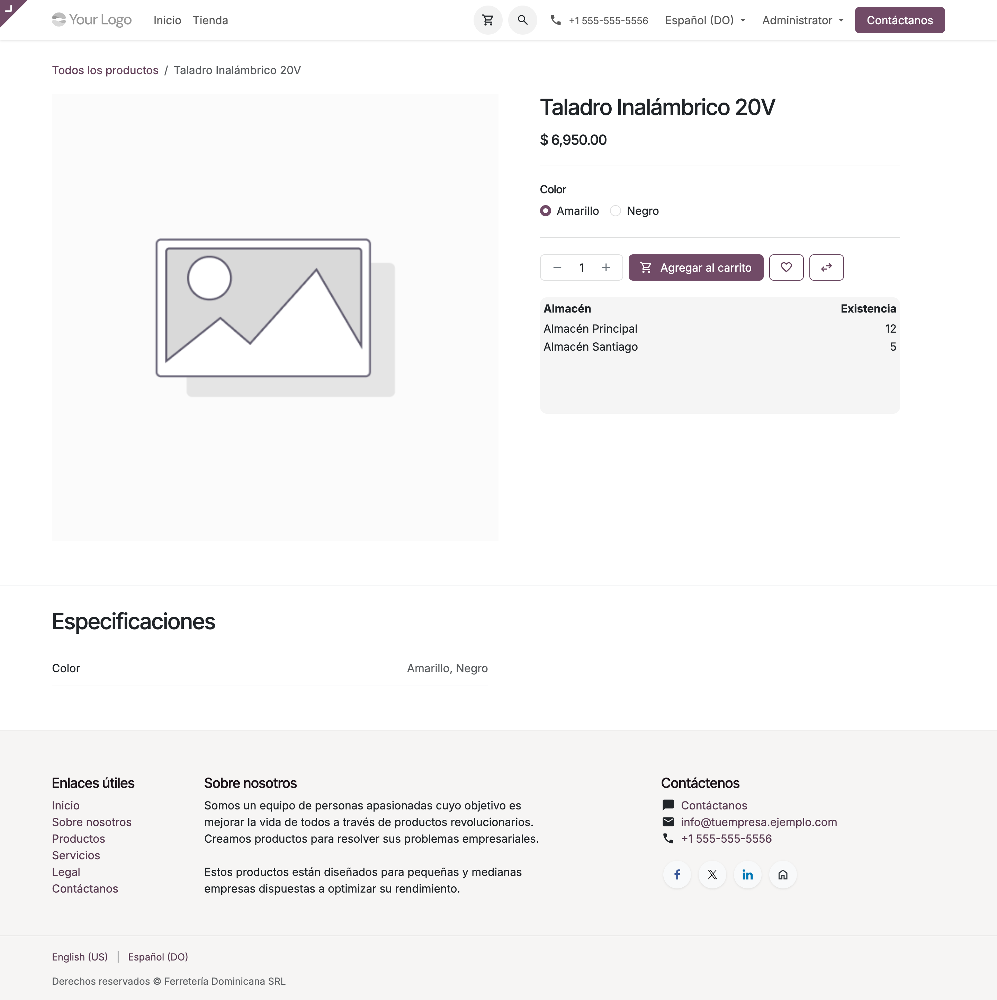
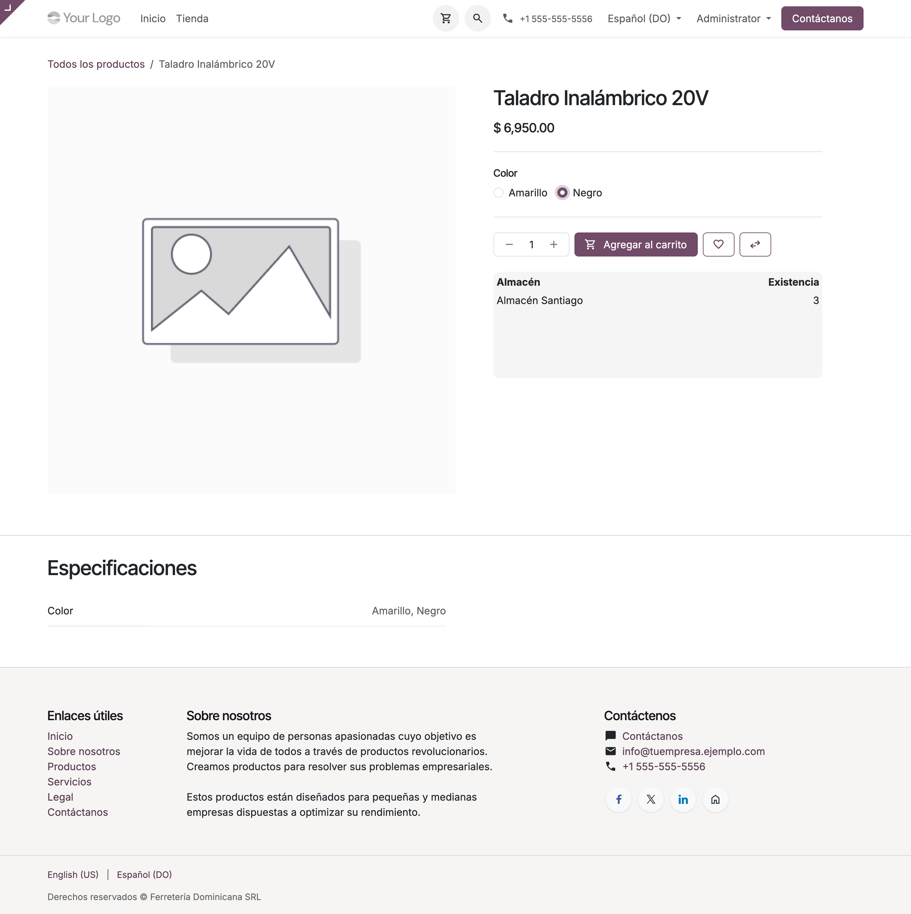
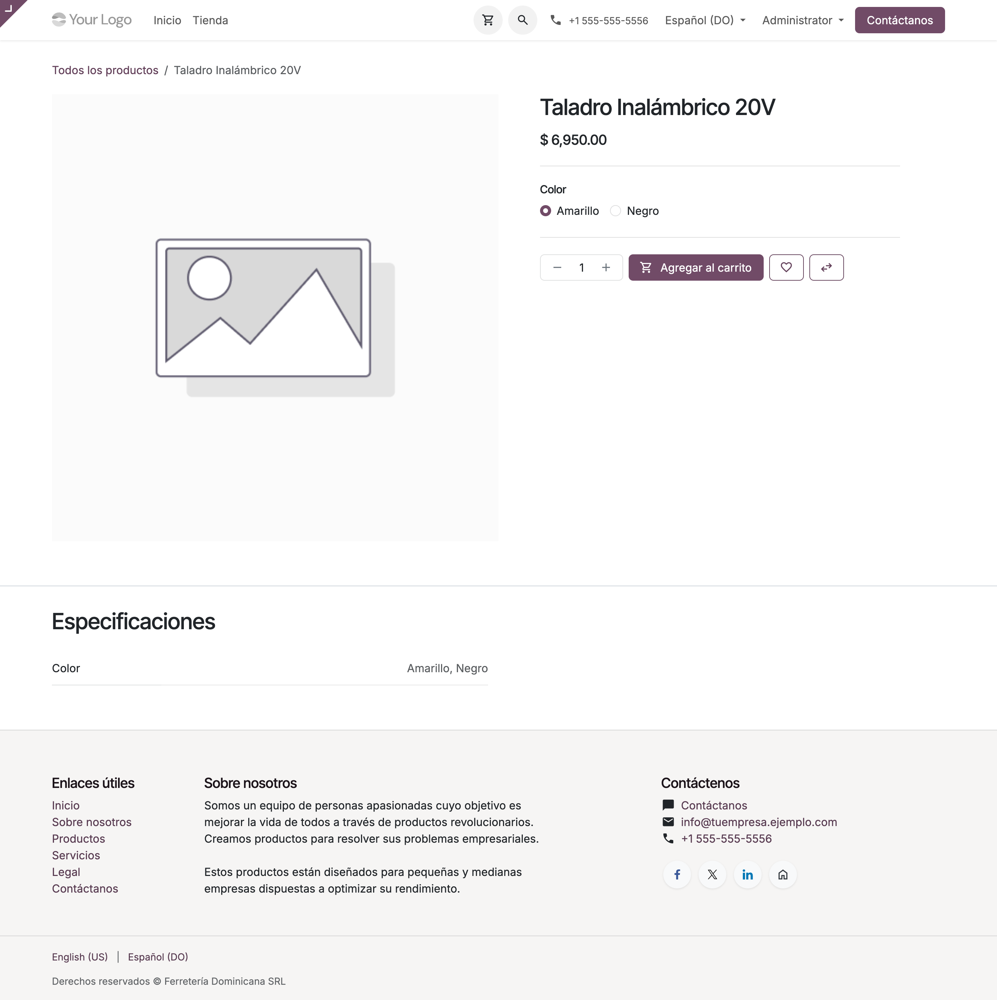

# Disponibilidad por almacén en la tienda — Manual de usuario (website_stock_availability, Odoo 20.0)

> Manual generado con `tools/manual-generator`. Las capturas se regeneran ejecutando el generador contra una base `test_v20_<módulo>`.

Este módulo muestra, en la página del producto de la tienda en línea, **en qué almacenes hay existencia** del producto y, si se desea, **cuántas unidades** hay en cada uno. La tabla aparece debajo del botón *Agregar al carrito* y se actualiza sola al cambiar de variante (color, talla, etc.).

Odoo 20.0 solo muestra la cantidad total disponible (o la de un único almacén configurado en el sitio web); no tiene un desglose por almacén, por eso el módulo se porta.

**Qué cambió en 20.0:** la configuración es la misma que en 19.0. La página del producto de Odoo 20.0 se reescribió y el módulo se adaptó a ella. Además:

- Los encabezados de la tabla (*Almacén*, *Existencias*, *Disponible*) ahora salen en español; antes aparecían en inglés.
- En el modo *Mostrar solo almacén* la marca verde vuelve a verse (Odoo 20.0 ya no incluye la fuente de iconos que usaba el módulo).
- El ajuste en *Sitio web → Ajustes* tiene ahora una descripción.

## Requisitos previos

- Módulo **`website_stock_availability`** `20.0.1.0.0` instalado. Depende de **`website_sale`**, **`stock`** y **`website_sale_stock`**.
- Productos **con seguimiento de inventario** (*Rastrear inventario* marcado) y **publicados** en el sitio web.
- Para ver más de un almacén: opción **Almacenes múltiples** activa en *Inventario → Configuración → Ajustes*.
- La tabla solo se muestra a usuarios que tienen acceso de lectura a Inventario (por ejemplo, el personal interno). A los visitantes anónimos de la tienda no se les muestra (ver *Notas*).

## 1. Elegir qué se muestra en la tienda

**Sitio web → Configuración → Ajustes**, sección *Tienda*: **Mostrar almacén en el sitio web**. El campo *Mostrar existencias* tiene tres opciones:

- **Nada** (por defecto): no se muestra la tabla.
- **Mostrar solo almacén**: lista los almacenes con existencia, con una marca verde.
- **Mostrar almacén con existencias**: lista los almacenes con existencia y la cantidad disponible en cada uno.

El ajuste es por sitio web.

## 2. Elegir qué almacenes aparecen

**Inventario → Configuración → Almacenes**, abra el almacén: la casilla **Mostrar almacén en el sitio web** (debajo del *Nombre corto*) decide si el almacén puede aparecer en la tabla. Viene marcada en todos los almacenes.

## 3. Ocultar un almacén

Desmarque la casilla en los almacenes que no deben verse en la tienda (por ejemplo, un almacén de tránsito o de mercancía en cuarentena). Aunque tenga existencia, ese almacén no aparecerá en la tabla.

## 4. Existencias de ejemplo

En este ejemplo el *Taladro Inalámbrico 20V* tiene dos variantes:

- **Amarillo**: 12 en *Almacén Principal*, 5 en *Almacén Santiago* y 8 en *Almacén Tránsito* (oculto en la tienda).
- **Negro**: 3 en *Almacén Santiago*.

La tabla usa la **cantidad libre** (a mano menos lo reservado para otras entregas).

## 5. Página del producto: almacén con existencias

Con **Mostrar almacén con existencias**, debajo de *Agregar al carrito* aparece la tabla **Almacén / Existencias** de la variante seleccionada. Solo se listan los almacenes visibles que tienen existencia: *Almacén Tránsito* no aparece porque está oculto, aunque tenga 8 unidades.

## 6. Cambio de variante

Al elegir otra variante, la tabla se actualiza sin recargar la página. Para el color **Negro** solo aparece *Almacén Santiago* con 3 unidades.

## 7. Página del producto: solo almacén

Con **Mostrar solo almacén**, la tabla lista los mismos almacenes pero, en lugar de la cantidad, muestra una marca verde. Útil cuando no se quiere revelar cuántas unidades hay.

## 8. Página del producto: nada

Con **Nada**, la página del producto queda como la estándar de Odoo, sin la tabla de almacenes.

## Notas

- **Visitantes anónimos y clientes del portal no ven la tabla.** Para leer las existencias por almacén el usuario necesita acceso a Inventario; si no lo tiene, la página del producto funciona normalmente y la tabla simplemente no aparece (en la consola del navegador queda el mensaje `[website_stock_availability] stock_qty not available`). Es el mismo comportamiento que en 19.0.
- Solo aparecen almacenes de la **compañía actual** del usuario, con existencia libre mayor que cero y con *Mostrar almacén en el sitio web* marcado.
- Si el producto no está publicado, la tabla no se muestra.
- En el modo *Mostrar solo almacén* la marca roja (✗) nunca aparece: los almacenes sin existencia no se listan.
- El bloque de disponibilidad estándar de Odoo ("Solo quedan X unidades", *Agotado*, etc.) sigue funcionando igual; la tabla se agrega debajo.
