# QA — Generador de comprobantes de certificación e-CF

| | |
|---|---|
| **Tarea** | [#74565 Mejora Facturación Electrónica (Certificación en Odoo)](https://www.progressa.group/odoo/project.task/74565) |
| **PR** | [indexa-git/odoo-pro#1180](https://github.com/indexa-git/odoo-pro/pull/1180) — `feat(l10n_do_ecf_invoicing): generate DGII certification test documents` |
| **Instancia** | `odoo-pasteleriadeljardin-test-39486129` (Odoo 19.0e, `l10n_do_ecf_invoicing` 19.0.1.1.0, `l10n_do_document_pools` instalado) |
| **Compañía probada** | FACTORIA MARIANA SRL (RNC 130896038), emisora e-CF, gestor de secuencias activo |
| **Usuario** | `claude` (administrador) |
| **Fecha** | 2026-10-15 |

## Veredicto

**Funciona en lo principal, pero no lo aprobaría todavía.** El asistente genera, firma y envía los comprobantes; los controles de ambiente responden; los contadores de reintento leen bien los rechazos de la DGII. Hay **dos bugs confirmados** que conviene corregir antes de hacer merge (B1 y B2) y varias mejoras de uso.

No se pudo comprobar que la DGII **acepte** los documentos: el RNC 130896038 no tiene una postulación activa en CerteCF, y la DGII rechazó todos los envíos con `"El RNC Emisor 130896038, no tiene una postulación activa."` Es una limitación del ambiente de pruebas, no del código.

| Resultado | Cantidad |
|---|---|
| ✅ Casos que pasan | 14 |
| 🐞 Bugs | 4 (2 importantes, 2 menores) |
| 💡 Mejoras sugeridas | 8 |

## Preparación

Las dos compañías de la instancia estaban en ambiente **TesteCF**. Para probar, FACTORIA MARIANA se pasó a **CerteCF** de forma temporal y **se devolvió a TesteCF** al terminar.

Estado de las secuencias (pools) del diario *Ventas* / *Compras* durante la prueba:

| Tipo | Secuencia | Tipo | Secuencia |
|---|---|---|---|
| E31 | ✅ válida | E41 | ⛔ borrador |
| E32 | ✅ válida | E43 | ⛔ borrador |
| E33 | ⛔ borrador | E44 | ✅ válida |
| E34 | ✅ válida | E45 | ✅ válida |
| E46 | ⛔ borrador | E47 | ⛔ borrador |

## Casos de prueba

### 1. Disponible solo en Certificación ✅

Con el ambiente en **TesteCF**, `action_open_wizard()`, `default_get()` y `action_generate()` se niegan con un error en las dos compañías:

> Esta acción solo está disponible mientras el entorno e-CF de la compañía sea «Certificación». Entorno actual: TesteCF.

En **Ajustes**, el bloque solo aparece en CerteCF:

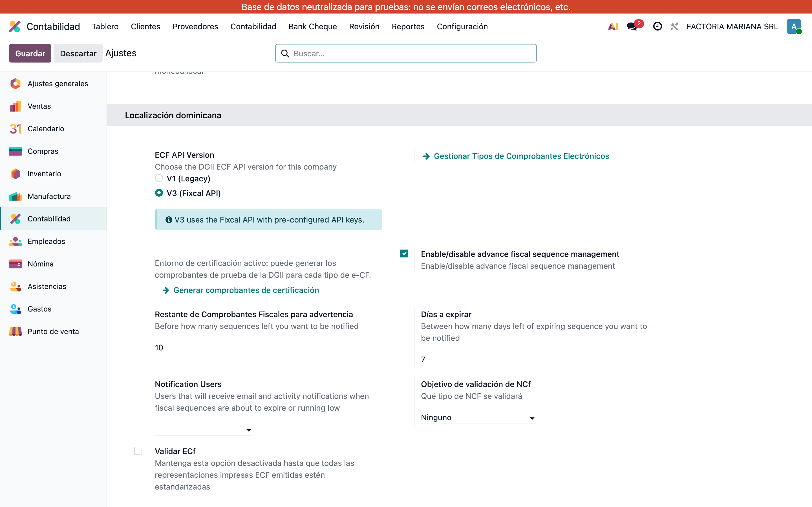

**Cambio de ambiente con el asistente ya abierto:** si se crea el asistente en CerteCF y se pasa la compañía a TesteCF antes de pulsar *Generar*, `action_generate()` se niega. ✅

### 2. Puntos de entrada ✅ (con observaciones)

| Entrada | Resultado |
|---|---|
| Ajustes → Contabilidad → Localización dominicana → *Generar comprobantes de certificación* | ✅ Abre el asistente |
| Contabilidad → Configuración → DGII → *Comprobantes de certificación e-CF* | ✅ Abre el asistente |
| Lista de facturas → Acciones → *Generar comprobantes de certificación* | ✅ Abre el asistente, **pero solo después de seleccionar al menos una factura** (ver M1) |

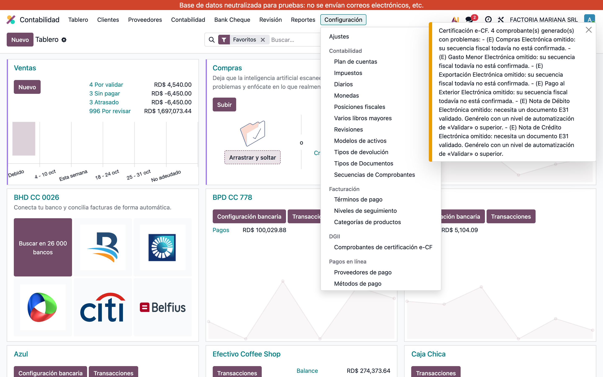

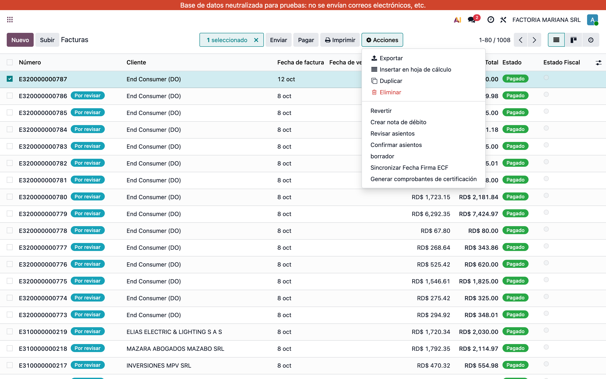

### 3. Propuesta inicial del asistente ✅ (con observaciones)

- Una línea por cada tipo e-CF habilitado (E31 a E47) ✅
- Los tipos con la secuencia sin confirmar salen **desmarcados** y con el badge *Sin confirmar* ✅
- Se proponen el diario de venta y el de compra correctos (*Ventas* / *Compras*) ✅
- Se reutilizan los contactos que ya tienen el RNC (ITERATIVO SRL, MICM) en vez de duplicarlos ✅

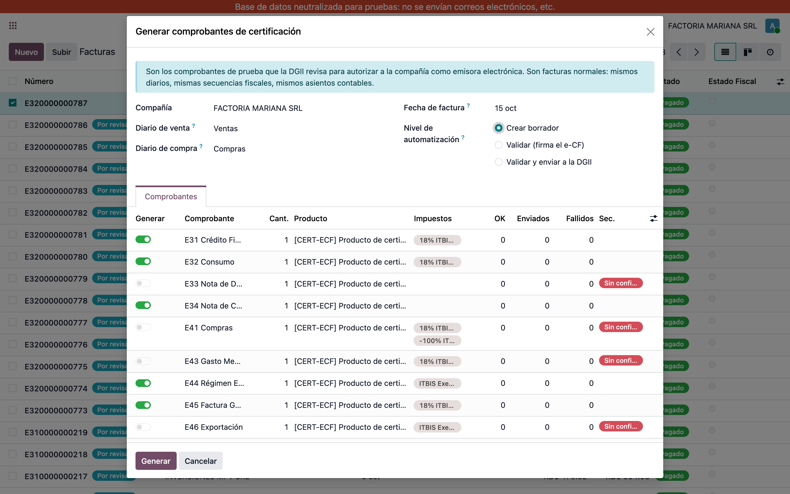

### 4. Nivel «Crear borrador» ✅ / 🐞

Se generó con la selección por defecto (E31, E32, E34, E44, E45).

- Se crearon 4 borradores: E31, E32, E44 y E45 ✅
- E34 se omitió con un mensaje claro: necesita un E31 validado ✅
- **🐞 B1**: el aviso lista como «omitidos» tipos que **no** estaban marcados (E33, E41, E43, E46, E47)

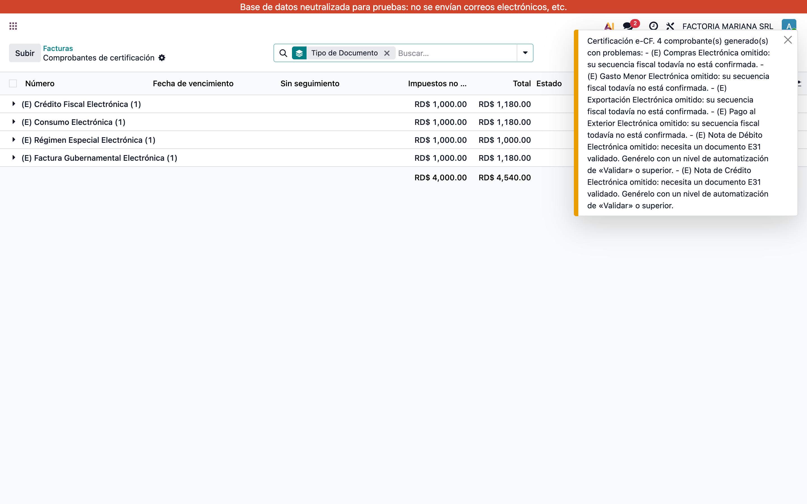

### 5. Nivel «Validar (firma el e-CF)» ✅ / 🐞

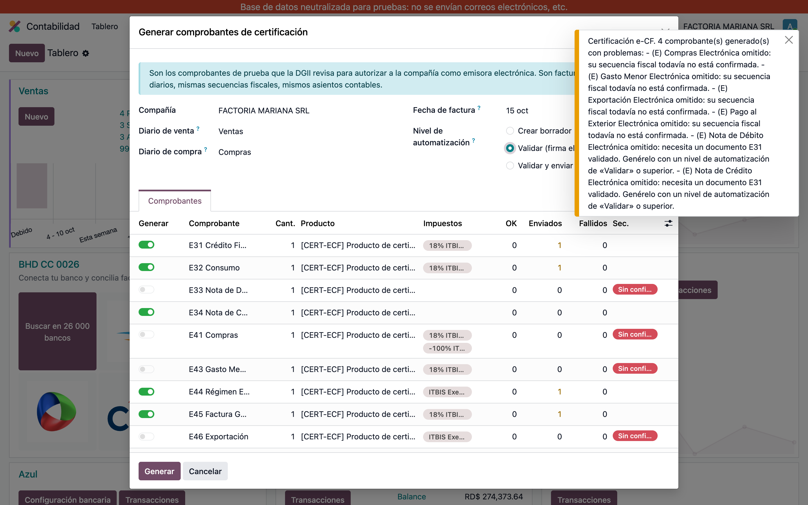

| Documento | NCF | Estado | Envío |
|---|---|---|---|
| E31 | E310000000220 | Publicado | Firmado y pendiente |
| E32 | E320000000788 | Publicado | Firmado y pendiente |
| E34 (sobre E310000000220) | E340000000013 | Publicado | Firmado y pendiente |
| E44 | E440000000001 | Publicado | Firmado y pendiente |
| E45 | E450000000003 | Publicado | Firmado y pendiente |

- Los documentos se firman y toman la secuencia autorizada de la compañía ✅
- La nota de crédito E34 se construye sobre el E31 del mismo lote, con un reverso total ✅
- **🐞 B2**: E33, aunque estaba desmarcado y tenía la secuencia sin confirmar, **se intentó crear** y falló con un mensaje técnico en inglés:

> (E) Nota de Débito Electrónica: Nota de Débito Electrónica is not a valid fiscal sequence

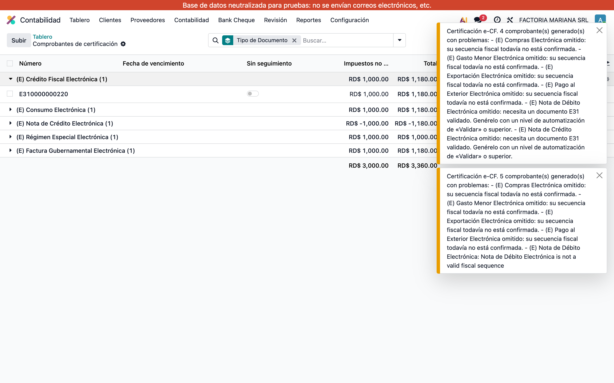

### 6. Reapertura y contadores ✅ / 🐞

Al volver a abrir el asistente, las columnas OK / Enviados / Fallidos reflejan lo que ya se generó:

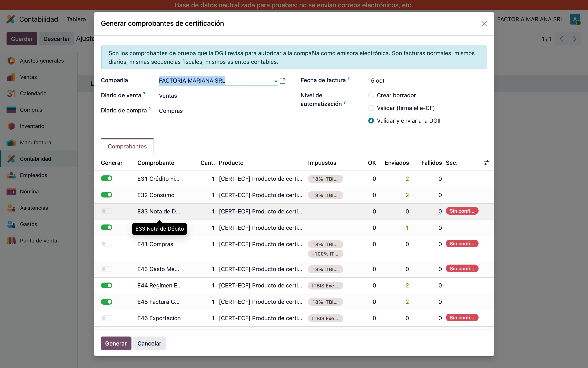

- **🐞 B3**: los **borradores** se cuentan como «Enviados» (E31 muestra 2 = 1 borrador + 1 firmado que nunca se envió). Ver detalle abajo.

### 7. Nivel «Validar y enviar a la DGII» ✅ (rechazado por la DGII)

| Documento | NCF | Respuesta DGII |
|---|---|---|
| E31 | E310000000221 | Rechazado (código 145): RNC sin postulación activa |
| E32 | E320000000789 | Rechazado de inmediato (RFCE): RNC sin postulación activa |
| E34 | E340000000014 | Rechazado (código 614): RNC sin postulación activa |
| E44 | E440000000002 | Rechazado (código 145): RNC sin postulación activa |
| E45 | E450000000004 | Rechazado (código 145): RNC sin postulación activa |

- Los documentos se envían y reciben trackId ✅
- Los rechazados se cancelan solos, que es el comportamiento que el módulo ya tenía ✅
- 💡 El aviso al terminar no dice nada del rechazo de E32 (ver M3)

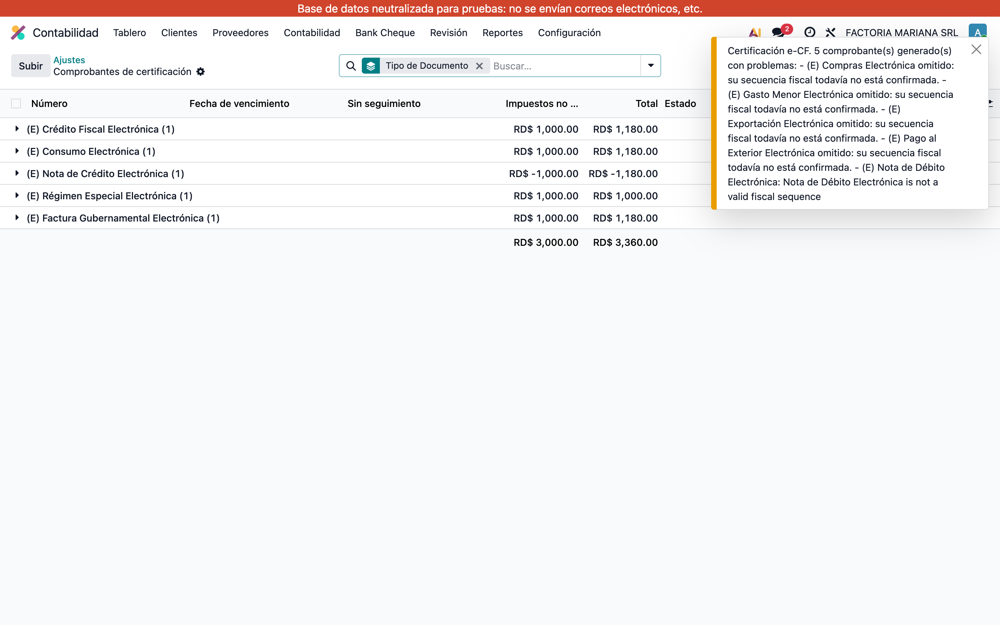

### 8. E32 Consumo ≥ RD$250,000 ✅

Es el caso que July tuvo que completar a mano. Se generó un E32 con un precio de 260,000 (total RD$306,800):

- Sale como e-CF **completo**, con trackId propio (`b78dd06d-…`), y no como resumen RFCE ✅
- La DGII lo rechazó por el mismo motivo de la postulación, así que no se pudo ver la aceptación

Para hacerlo hay que mostrar la columna opcional **Precio** y cambiarlo a mano. No se pueden generar en un mismo lote un E32 menor y uno mayor de RD$250,000 (ver M2).

### 9. Reintento después de rechazos ✅

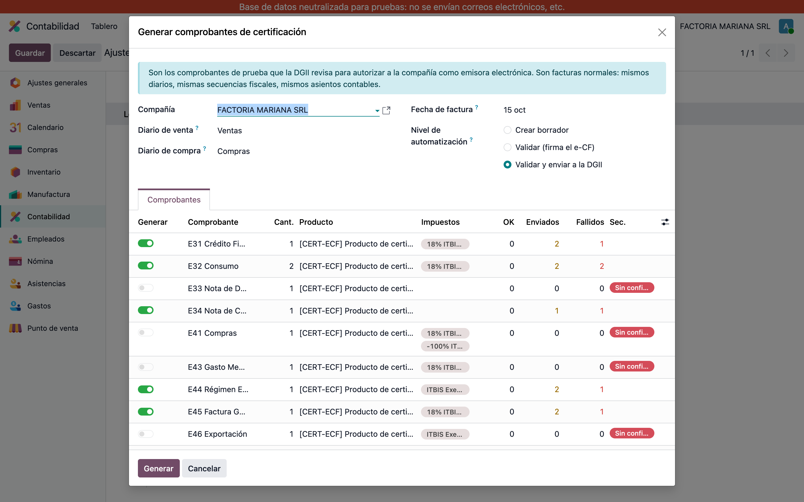

- La cantidad propuesta es igual a la cantidad de rechazados (E32 = 2) y el tipo queda marcado ✅
- Los tipos sin secuencia válida siguen desmarcados ✅

### 10. Validaciones de entrada ✅

| Caso | Resultado |
|---|---|
| Nada seleccionado | «Seleccione al menos un tipo de documento con una cantidad mayor que cero.» ✅ |
| Cantidad 0 | Mismo mensaje ✅ |
| Solo E34 en nivel borrador | «No se pudo generar ningún comprobante: … necesita un documento E31 validado…» ✅ |

### 11. Fuera de Certificación, las entradas siguen visibles 💡

Con la compañía en TesteCF, que en la práctica es como estar en producción, la acción de la lista y el menú **siguen apareciendo** para todos los usuarios y, al pulsarlos, dan error:

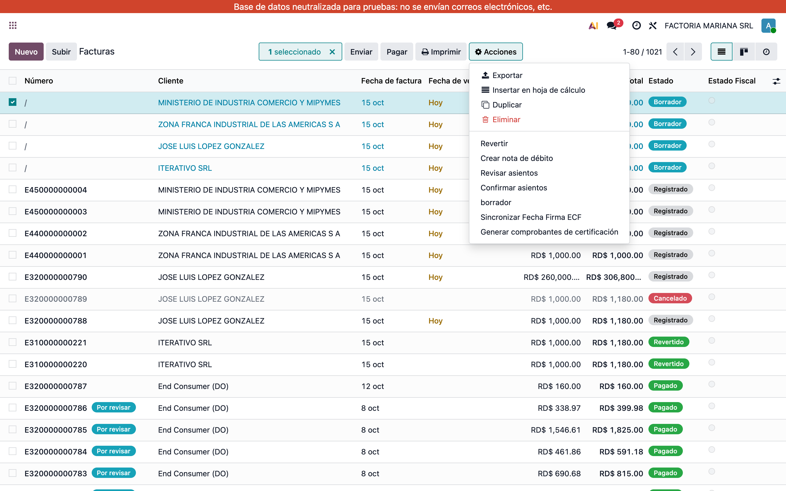

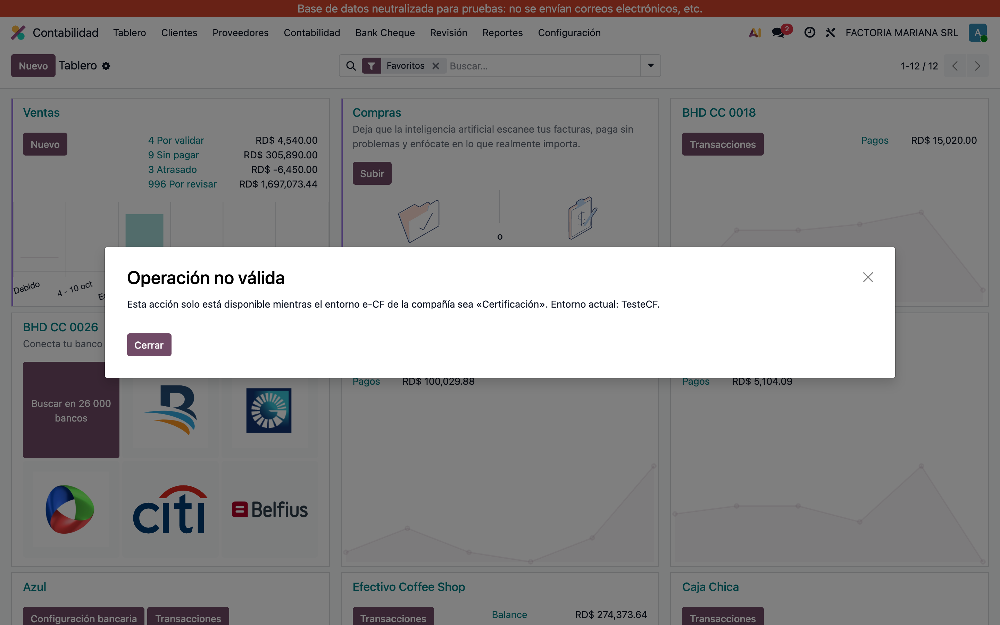

## Bugs

### ✅ B1 — Los tipos desmarcados vuelven al servidor como seleccionados (importante) — corregido en `22ba42e8`

`selected` se vuelve de solo lectura con `readonly="sequence_state != 'ready'"`, pero no tiene `force_save`, y en el modelo tiene `default=True`. El cliente web no envía los campos de solo lectura, así que esas líneas llegan al servidor con `selected = True`.

- **Efecto que se vio:** el aviso de resultados llena la lista con tipos que el usuario no pidió (E33, E41, E43, E46, E47 en cada corrida).
- **Riesgo:** si la secuencia se confirma entre que se abre el asistente y se pulsa *Generar*, se generarían documentos que el usuario desmarcó.
- **Fix:** poner `force_save="1"` en `selected` (y en `qty`, que tiene el mismo `readonly`), o `default=False` en el modelo.

### ✅ B2 — Las notas (E33/E34) no comprueban la secuencia (importante) — corregido en `22ba42e8`

`_generate_invoices()` revisa `_l10n_do_sequence_state()` antes de crear, pero `_generate_notes()` no lo hace. Sumado a B1, E33 (con el pool en borrador) llegó hasta `account.debit.note` y falló con un error técnico sin traducir: `Nota de Débito Electrónica is not a valid fiscal sequence`.

- **Fix:** aplicar el mismo control de secuencia en `_generate_notes()` (con el diario del documento de origen) y dar el mensaje de siempre: «su secuencia fiscal todavía no está confirmada».

### 🐞 B3 — Borradores y documentos firmados sin enviar cuentan como «Enviados» (menor)

`PENDING_STATES` incluye `to_send`, que es el estado de envío de **cualquier borrador**. La columna se llama «Enviados» (*Sent*), pero cuenta borradores que nunca salieron de Odoo.

- Además, el tipo sigue marcado porque `accepted == 0`, y cada corrida en nivel borrador **duplica** borradores.
- **Fix:** contar aparte los movimientos con `state = 'draft'` (o excluirlos), cambiar el nombre de la columna a «Pendientes», y quizá ofrecer validar o enviar los borradores que ya existen en vez de crear otros.

### 🐞 B4 — Se propone un impuesto archivado en E41 (menor)

La receta E41 incluye `ret_10_income_person`, que en esta compañía es **«-10% ISR Fee» archivado** (`active = False`). La línea lo lleva en `tax_ids` aunque en la pantalla solo se ven dos etiquetas. Eso puede dar un documento con una retención que el usuario no ve.

- **Fix:** en `_get_recipe_taxes()`, descartar los impuestos que no están activos (y registrarlo en el log, como ya se hace con los que faltan).

## Mejoras sugeridas

| # | Mejora | Motivo |
|---|---|---|
| M1 | Acción de la lista sin exigir selección | Hoy hay que marcar una factura cualquiera para que aparezca *Acciones → Generar…*. Una opción es un botón en la vista de lista (o en el panel de control) que solo se vea en CerteCF |
| M2 | Soporte explícito para E32 < 250k y ≥ 250k | El set de pruebas de la DGII pide los dos casos. Con una sola línea por tipo hay que hacer dos corridas y sacar a mano la columna *Precio*, que está oculta. Se podría añadir una línea «E32 ≥ 250,000» o dejar visible el precio |
| M3 | Informar el resultado DGII en el aviso | Tras enviar, el aviso no dice cuántos se aceptaron o rechazaron. E32 se rechazó al instante y el usuario solo ve el aviso de «omitidos» |
| M4 | Avisos más legibles | Los saltos de línea `\n` no se ven en la notificación (sale un solo párrafo) y el aviso es *sticky*, así que se acumulan (ver captura 08) |
| M5 | Ocultar el menú y la acción fuera de Certificación | Hoy se ven siempre y dan error. Se puede condicionar el menú por grupo o con una acción que redirija con un mensaje amable |
| M6 | Mostrar la etiqueta del ambiente, no el código | «Entorno actual: TesteCF» → «Entorno actual: Pruebas» |
| M7 | Evitar escrituras al abrir el asistente | `default_get()` crea contactos y el producto `CERT-ECF` con solo abrir (aunque luego se cancele). Mejor crearlos en `action_generate()` |
| M8 | Contacto gubernamental con un tipo de contribuyente incorrecto | Se reutilizó MICM (401007355) con el tipo `taxpayer`, porque el código solo pone el tipo si está vacío. Para E45, conviene avisar o forzar `governmental` en el documento de certificación |

Detalles menores de la interfaz:

- Las columnas *Comprobante*, *Producto* e *Impuestos* se cortan («E31 Crédito Fi…», «18% ITBI…»).
- Los documentos que quedan en nivel *Validar* (firmados y pendientes) no se envían en una corrida posterior de nivel *Enviar*: hay que enviarlos desde la factura.
- Notas E33/E34: solo se pueden emitir sobre un E31 del **mismo lote**. Si se rechaza solo la nota, hay que generar también un E31 nuevo.

## Lo que quedó en la instancia

- **Ambiente** de las dos compañías: de vuelta en **TesteCF**.
- **Documentos de certificación** creados en FACTORIA MARIANA (`l10n_do_is_certification_doc = True`), que se pueden filtrar con *Comprobantes de certificación*:
  - 4 borradores (E31, E32, E44, E45)
  - 5 firmados sin enviar: E310000000220, E320000000788, E340000000013, E440000000001, E450000000003
  - 6 enviados y cancelados por el rechazo de la DGII: E310000000221, E320000000789, E320000000790, E340000000014, E440000000002, E450000000004
- **Contactos creados** por el asistente: JOSE LUIS LOPEZ GONZALEZ, ZONA FRANCA INDUSTRIAL DE LAS AMERICAS S A, ECF CERTIFICATION FOREIGN CUSTOMER. **Producto:** `CERT-ECF`.

## Siguiente paso recomendado

1. ~~Corregir B1 y B2~~ — hecho en el commit `22ba42e8` de la rama de la PR, con 2 tests de regresión (fallan sin el fix, pasan con él; la suite de certificación queda en 18/18).
2. Corregir B3 y B4.
3. Repetir el nivel *Enviar* en una compañía con una **postulación activa** en CerteCF para confirmar la aceptación de la DGII, sobre todo de E32 ≥ 250k, E33 y E34.
